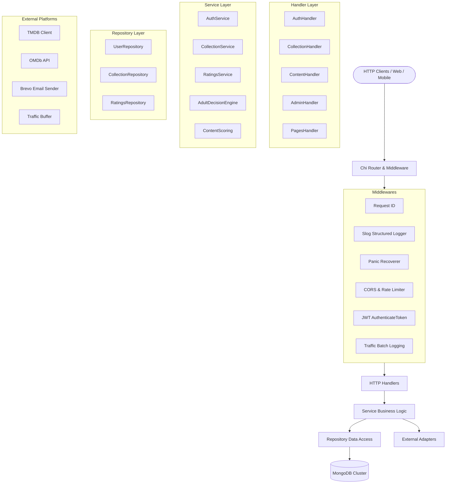

# Soulstash Backend (Go)

Production-grade, modular, low-latency, and audit-ready Go migration of the Soulstash backend.

---

## 1. Quickstart

### Prerequisites
- Go 1.24+ (verified with Go 1.27.3)
- Docker & Docker Compose (optional for local MongoDB container)

### Local Development
```bash
# Clone and enter directory
cd backend-go

# Run tests
go test -v ./...

# Build binary
go build -o bin/server ./cmd/server

# Run application
go run ./cmd/server
```

### Local Dev with Docker Compose
```bash
docker-compose up -d
```

---

## 2. Architecture Map

The project implements **Hexagonal (Ports & Adapters) Layered Architecture**:
- Inward dependency flow: `handler -> service -> repository -> domain`.
- Zero global mutable state; all components utilize constructor dependency injection.
- Standard library structured logging (`log/slog`) with zero secrets logged.



---

## 3. Directory Layout

```text
backend-go/
├── cmd/
│   └── server/
│       └── main.go                 # Application entrypoint & graceful signal handling
├── internal/
│   ├── config/                     # Strongly-typed environment configuration
│   ├── domain/                     # Core domain entities, models, and errors
│   ├── handler/                    # HTTP endpoints & Chi route registrations
│   ├── middleware/                 # RequestID, Logger, CORS, RateLimiter, JWT, Traffic
│   ├── platform/                   # External adapters: MongoDB, TMDB, Email, Traffic
│   ├── repository/                 # Data access interfaces & MongoDB implementations
│   ├── server/                     # Chi HTTP server setup, health probes, SPA serving
│   └── service/                    # Core business logic: Auth, Collections, Ratings, Scoring
├── docs/                           # Comprehensive documentation suite
│   ├── architecture/               # Architecture overview and ADR-001 through ADR-008
│   ├── api/                        # OpenAPI 3.0 specification (openapi.yaml)
│   ├── migration/                  # Discovery, parity matrix, quirks, assumptions, cutover
│   ├── operations/                 # Config reference, runbook
│   ├── performance/                # Micro-benchmarks, latency & throughput analysis
│   ├── security/                   # Security review and vulnerability audit
│   └── testing/                    # Test strategy, fixtures guide, test execution
├── loadtest/                       # k6 and Vegeta load testing scenarios
├── testdata/                       # Golden response fixtures captured from Node.js
├── Dockerfile                      # Multi-stage minimal non-root container
├── docker-compose.yml              # Local development stack
├── Makefile                        # Build, test, lint, cover, docker, load targets
└── .golangci.yml                   # GolangCI-Lint static analysis configuration
```

---

## 4. Documentation Index

- [Architecture Overview](file:///docs/architecture/overview.md)
- [Architecture Decision Records (ADRs)](file:///docs/architecture/decisions/)
- [API Specification (OpenAPI 3.0)](file:///docs/api/openapi.yaml)
- [Parity Matrix (All 95 Endpoints)](file:///docs/migration/parity-matrix.md)
- [Known Quirks & Node.js Edge Cases](file:///docs/migration/known-quirks.md)
- [Configuration Reference](file:///docs/operations/config-reference.md)
- [Operations Runbook](file:///docs/operations/runbook.md)
- [Performance Benchmarks](file:///docs/performance/benchmarks.md)
- [Security Review](file:///docs/security/review.md)
- [Production Cutover Plan](file:///docs/migration/cutover-plan.md)
- [Testing Guide](file:///docs/testing/README.md)

---

## 5. Quality Gates

Before any deployment, all gates must pass cleanly:
```bash
make test       # Unit, integration, contract tests PASS
make test-race  # Zero race conditions detected
make lint       # Zero golangci-lint issues
make bench      # Micro-benchmarks
make build      # Production binary builds cleanly
```
