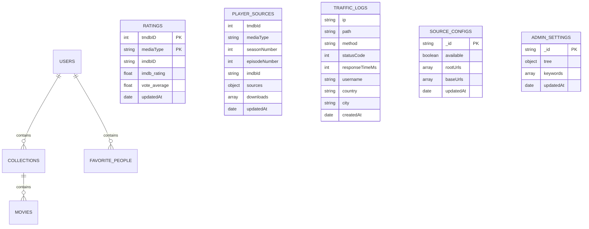

# Soulstash Data Model & Database Architecture

## Overview
Soulstash uses **MongoDB** as its primary persistent datastore. Collections store users and their nested collections, ratings caches, scraped player source history, application metrics, admin decision configuration, and access traffic logs.

---

## Collections Inventory

### 1. `users`
Primary user identity and personal libraries.
- **Fields**:
  - `_id`: `ObjectId` - Unique user ID.
  - `username`: `string` - Unique username (3-30 chars).
  - `email`: `string` - User email address (optional, used in OTP verification).
  - `password`: `string` - Bcrypt hashed password.
  - `fullName`: `string` - Display name.
  - `firstName`: `string` - First name extracted from full name.
  - `lastName`: `string` - Last name extracted from full name.
  - `bio`, `dateOfBirth`, `instagramHandle`, `xHandle`, `youtubeHandle`: `string` - Optional profile details.
  - `avatar`: `string` - Data URI base64 or remote URL.
  - `admin`: `boolean` - Admin privileges flag.
  - `adminMode`: `int` - Admin mode preference (`0` or `1`).
  - `showAdult`: `boolean` - Whether user has enabled adult/NSFW content browsing.
  - `collectionVersion`: `int` - Monotonically increasing revision counter for cache invalidation.
  - `collections`: `array` - Embedded list of user collections:
    - `_id` / `name`: `string` - Collection title (unique per user, e.g. "Watched", "Watchlist", custom).
    - `isDeletable`: `boolean` - `false` for system collections ("Watched", "Watchlist").
    - `isPublic`: `boolean` - Whether visible to other users.
    - `isPublished`: `boolean` - Whether featured in platform public directory (requires >= 6 items).
    - `description`: `string` - User-provided description.
    - `banner`: `string` - Collection header image URL.
    - `movieCount`: `int` - Cached item count.
    - `movies`: `array` - List of saved media titles:
      - `movieId` / `seriesId` / `id`: `int` - TMDB content identifier.
      - `title`: `string` - Title.
      - `poster_path`: `string` - Image path.
      - `media_type`: `"Movie"` | `"Series"`.
      - `vote_average`: `float | null`.
      - `imdb_rating`: `float | null`.
      - `imdb_id`: `string`.
      - `rating_lookup_attempted`: `boolean`.
      - `addedAt`: `date`.
    - `createdAt`, `updatedAt`: `date`.
  - `favoritePeople`: `array` - List of favorited actors/directors.
  - `favoritePeoplePublic`: `boolean` - Whether favorite people list is public.
  - `followers`: `array[string]` - List of follower usernames.
  - `following`: `array[string]` - List of following usernames.
  - `createdAt`, `updatedAt`: `date`.
- **Indexes**:
  - `{ username: 1 }` (unique, name: `username_unique_index`)

---

### 2. `Ratings`
Shared IMDb and TMDB cached rating scores to minimize external API rate limits.
- **Fields**:
  - `_id`: `ObjectId`.
  - `tmdbID`: `int` - TMDB numeric ID.
  - `mediaType`: `string` - `"Movie"` or `"Series"`.
  - `type`: `string` - Duplicate of `mediaType` for compatibility.
  - `imdbID`: `string` - External IMDb ID (e.g. `"tt0111161"`).
  - `imdb_rating`: `float | null` - Rating from OMDb or sentinel `10.0` if not found.
  - `vote_average`: `float | null` - TMDB vote average.
  - `updatedAt`: `date`.
- **Indexes**:
  - `{ tmdbID: 1, mediaType: 1 }` (unique, name: `ratings_tmdb_media_unique`)
  - `{ imdbID: 1, mediaType: 1 }` (sparse, name: `ratings_imdb_media_index`)

---

### 3. `PlayerSources`
Scraped and resolved playable video streaming provider sources and download links.
- **Fields**:
  - `_id`: `ObjectId`.
  - `searchKey`: `string` - e.g. `"interstellar-2014"` or `"breaking-bad-1x1"`.
  - `mediaType`: `string` - `"movie"` or `"series"`.
  - `tmdbId`: `int | null`.
  - `imdbId`: `string`.
  - `title`: `string`.
  - `year`: `int | null`.
  - `seasonNumber`: `int | null` (series only).
  - `episodeNumber`: `int | null` (series only).
  - `sources`: `map[string][]string` - Mapping provider codes (`smwh`, `rpmshre`, `upnshr`, `strmp2`, `flls`, `youtube`) to historical and active iframe/embed URLs.
  - `downloads`: `array[string]` - Scraped direct download URLs.
  - `updatedAt`, `createdAt`: `date`.
- **Indexes**:
  - `{ tmdbId: 1, mediaType: 1, seasonNumber: 1, episodeNumber: 1 }` (name: `player_sources_tmdb_lookup`)
  - `{ imdbId: 1, mediaType: 1 }` (sparse, name: `player_sources_imdb_lookup`)

---

### 4. `SourceConfigs`
Runtime configurable scraper endpoints.
- **Document `_id: "multimovies"`**:
  - `className`: `"multimovies"`.
  - `available`: `boolean`.
  - `rootUrls`: `array[string]`.
  - `baseUrls`: `array[string]`.
  - `createdAt`, `updatedAt`: `date`.

---

### 5. `AppMetrics`
Application-wide operational counters.
- **Document `_id: "ratings_api_counters"`**:
  - `tmdbDetailFetchCount`: `int`.
  - `omdbFetchCount`: `int`.
  - `createdAt`, `updatedAt`: `date`.

---

### 6. `admin_setting_monolith`
Dynamic content moderation and adult filtering rule tree.
- **Document `_id: "adult_criteria"`**:
  - `tree`: Nested decision tree node JSON.
  - `updatedAt`: `date`.
- **Document `_id: "adult_keywords_config"`**:
  - `keywords`: Array of `{ id: string, name: string }`.
  - `updatedAt`: `date`.

---

### 7. `TrafficLogsMonolith`
Rolling traffic telemetry for admin monitoring and geographical analytics.
- **Fields**:
  - `ip`: `string`.
  - `domain`: `string`.
  - `path`: `string`.
  - `method`: `string`.
  - `statusCode`: `int`.
  - `responseTimeMs`: `int`.
  - `username`: `string`.
  - `userAgent`: `string`.
  - `device`: `"mobile"` | `"tablet"` | `"desktop"`.
  - `country`, `city`: `string`.
  - `ll`: `[latitude, longitude] | null`.
  - `referer`: `string`.
  - `createdAt`: `date`.
- **Indexes**:
  - `{ createdAt: 1 }` with `expireAfterSeconds: 2592000` (30-day TTL).

---

### 8. `password_resets`
Temporary verification records for password recovery.
- **Fields**:
  - `email`: `string`.
  - `otp`: `string`.
  - `createdAt`: `date`.
  - `expiresAt`: `date` (15 minutes from creation).
