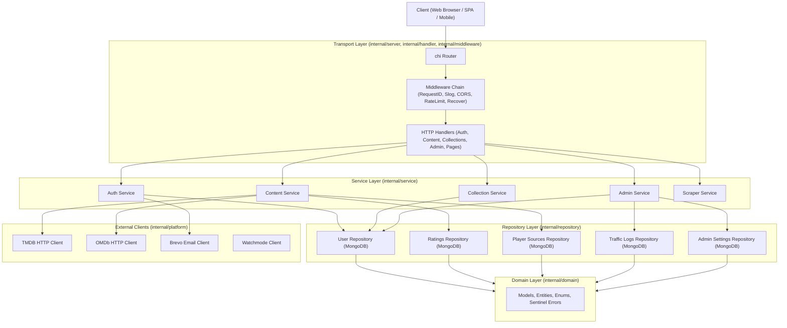
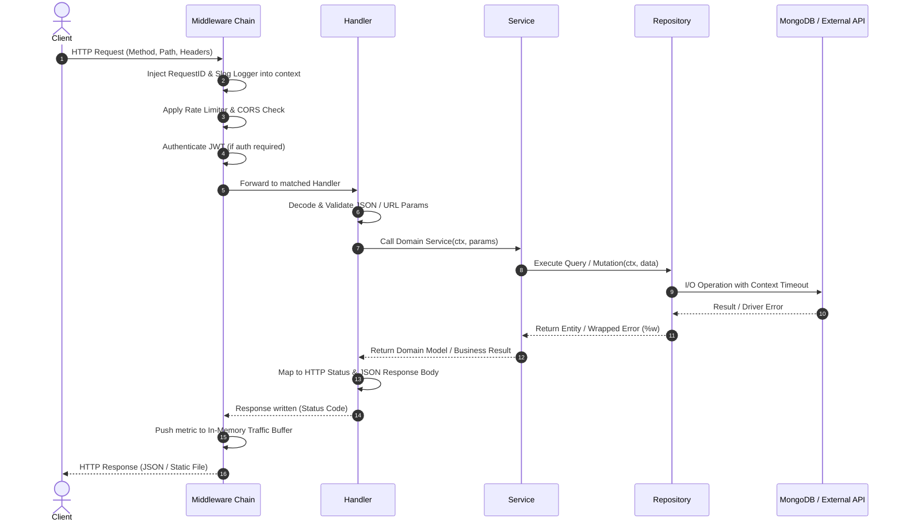

# System Architecture & Layered Design

## Overview
The Soulstash Go backend is engineered according to Clean/Hexagonal Architecture principles. Dependencies point strictly inwards:
`HTTP / Transport Layer` $\rightarrow$ `Service / Business Logic Layer` $\rightarrow$ `Repository / Data Layer` $\rightarrow$ `Domain Entities`.



---

## Request Lifecycle

Every HTTP request follows a deterministic pipeline with structured logging, distributed tracing, and panic recovery:



---

## Folder Map & Package Responsibilities

```
backend-go/
├── cmd/
│   └── server/
│       └── main.go                  # Application entrypoint: wire DI, handle signals, listen
├── internal/
│   ├── config/                      # Strongly-typed environment configuration and validation
│   ├── server/                      # HTTP server initialization and chi router mounting
│   ├── middleware/                  # RequestID, logging, CORS, rate-limiting, auth, recovery
│   ├── handler/                     # HTTP transport controllers, JSON decoding, status codes
│   ├── service/                     # Business workflows, scoring algorithms, decision tree
│   ├── repository/                  # MongoDB collection queries, indexes, and aggregations
│   ├── domain/                      # Domain entities, constants, interfaces, and sentinel errors
│   └── platform/                    # Outbound HTTP clients (TMDB, OMDb, Brevo) and DB driver
├── testdata/
│   └── golden/                      # JSON contract test fixtures comparing Node vs Go
├── loadtest/                        # k6 and Vegeta load testing scenarios
├── docs/                            # Architecture, ADRs, migration logs, runbooks
├── Dockerfile                       # Non-root multi-stage container
├── docker-compose.yml               # Local dependencies (MongoDB container)
├── Makefile                         # Standard automation targets
└── .golangci.yml                    # Linter configuration
```

---

## Architectural Principles

1. **Inversion of Control**: Interfaces are declared at consumer boundaries (`internal/service` defines repository interfaces it needs; `internal/repository` implements them).
2. **Context Propagation**: Every database call, outbound HTTP request, and scraper invocation accepts `context.Context` with an enforced timeout.
3. **No Global State**: Zero global mutable variables. All components are instantiated via explicit constructors (`New...`) and wired in `main.go`.
4. **Resilience & Graceful Shutdown**: Listens for `SIGINT` / `SIGTERM`, allows in-flight requests 10 seconds to finish, flushes remaining traffic logs to MongoDB, and closes client connections cleanly.
