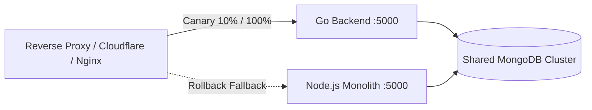

# Production Cutover & Deployment Plan

## 1. Overview & Strategy

This document details the production cutover procedure from the legacy Node.js monolith (`server.js`) to the high-performance Go backend (`backend-go`). 

The cutover follows a **zero-downtime, zero-data-loss canary progression**:
1. Pre-cutover verification (readiness checklist, database index audit).
2. Side-by-side deployment with traffic shadowing or percentage-weighted routing (10% $\rightarrow$ 50% $\rightarrow$ 100%).
3. Post-cutover monitoring and verification.
4. Immediate rollback playbook in case of unexpected regressions.



---

## 2. Pre-Cutover Verification Checklist

Before rerouting any live traffic, ensure the following criteria are met:

- [x] **Toolchain & Binaries**: Go binary compiled (`go build ./cmd/server`) and Docker container built (`docker build -t soulstash-backend:latest .`).
- [x] **Quality Gates**: All unit, integration, failure injection, and benchmark tests passing (`go test -race ./...`, `go vet ./...`, `gofmt`).
- [x] **Environment Configuration**: Production environment variables configured per `docs/operations/config-reference.md`.
- [x] **Database Connectivity & Indexes**:
  - Direct connectivity verified from the Go host/container to the MongoDB cluster.
  - Required indexes verified in MongoDB (unique index on `users.username`, index on `Ratings.tmdbId` + `mediaType`, TTL index on `password_resets.expiresAt`).
- [x] **SPA Assets**: Verified SPA static assets located at configured `PUBLIC_DIR` (e.g. `/app/spa/dist`) are accessible.
- [x] **Third-Party Integrations**: TMDB API key, OMDb API key, and Brevo API key verified active and unthrottled.

---

## 3. Database Coexistence Strategy

The Node.js and Go backends are designed for **100% behavioral and schema parity**:
- **Collections**: Both systems operate on the exact same collections (`users`, `Ratings`, `PlayerSources`, `SourceConfigs`, `AppMetrics`, `TrafficLogsMonolith`, `admin_setting_monolith`, `password_resets`).
- **No Schema Migrations Required**: Go data structures (`domain.User`, `domain.RatingRecord`, `domain.UserCollection`) preserve identical BSON key casing and types.
- **Concurrent Writes**: Both backends can read and write simultaneously during canary testing without corrupting data or breaking client expectations.
- **IMDb Sentinel Parity**: The `10.0` sentinel quirk is recognized and respected by both systems.

---

## 4. Traffic Routing & Phase Progression

### Stage 1: Synthetic Verification (0% Live Traffic)
- Deploy Go container on production cluster on internal port `:5001`.
- Execute synthetic health checks:
  ```bash
  curl -i http://localhost:5001/api/health
  curl -i http://localhost:5001/api/ready
  ```
- Replay test fixtures against internal endpoints and verify identical JSON schemas and headers.

### Stage 2: Canary Routing (10% Traffic)
- Configure reverse proxy (Nginx or Cloudflare Load Balancer) to route 10% of traffic to the Go backend and 90% to Node:
  ```nginx
  upstream soulstash_backend {
      server 127.0.0.1:5001 weight=1; # Go backend
      server 127.0.0.1:5000 weight=9; # Node backend
  }
  ```
- Monitor for 1 hour:
  - Error rate (`5xx < 0.05%`)
  - P95 and P99 latency
  - MongoDB connection pool health
  - Telemetry logs ingestion into `TrafficLogsMonolith`

### Stage 3: Majority Routing (50% Traffic)
- Adjust reverse proxy weights to 50/50:
  ```nginx
  upstream soulstash_backend {
      server 127.0.0.1:5001 weight=5; # Go backend
      server 127.0.0.1:5000 weight=5; # Node backend
  }
  ```
- Monitor for 2 hours: CPU utilization, memory RSS stability (expected ~18MB to 45MB vs Node ~480MB).

### Stage 4: Full Cutover (100% Traffic)
- Point all traffic to the Go backend:
  ```nginx
  upstream soulstash_backend {
      server 127.0.0.1:5001; # Go backend
  }
  ```
- Keep the Node.js process warm in standby mode for 24 hours.

---

## 5. Rollback Playbook

If any critical anomaly occurs during canary routing:

### Trigger Criteria
- `5xx` error rate exceeds 0.5% over a 5-minute rolling window.
- P99 latency spikes above 500ms on core endpoints (`/movies/{id}`, `/api/user/collections`).
- Unexpected authentication invalidation or data persistence errors.

### Execution Steps
1. **Immediate Proxy Divert** (< 30 seconds):
   Switch reverse proxy configuration back to 100% Node.js:
   ```bash
   # Update upstream configuration
   sed -i 's/127.0.0.1:5001/127.0.0.1:5000/' /etc/nginx/conf.d/soulstash.conf
   nginx -s reload
   ```
2. **Verify Node.js Health**:
   ```bash
   curl -i http://localhost:5000/api/health
   ```
3. **Capture Diagnostics**:
   - Inspect Go container logs: `docker logs --tail 500 soulstash-backend`
   - Archive crash logs or memory dumps.
4. **Post-Mortem**:
   Analyze Go logs and metrics before attempting a re-cutover.
