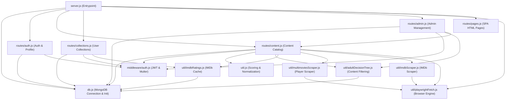

# Node.js Codebase Discovery & Analysis

## 1. Import Graph & Reachable Files

The application entrypoint is `server.js`. The import graph of reachable files is as follows:

### In-Scope Reachable Files
1. `server.js`
2. `db.js`
3. `middleware/auth.js`
4. `routes/auth.js`
5. `routes/content.js`
6. `routes/collections.js`
7. `routes/admin.js`
8. `routes/pages.js`
9. `util.js`
10. `util/adultDecisionTree.js`
11. `util/imdbRatings.js`
12. `util/imdbScraper.js`
13. `util/playwrightFetch.js`
14. `util/multimoviesScraper.js`
15. `assets/images/*` (Static assets)

---

## 2. Candidate Dead Code (Unreachable Non-Ignored Files)
- `tsconfig.json`: TypeScript configuration file not referenced by `server.js`.
- `capacitor.config.json`: Mobile client configuration.
- `vite.config.mjs`: Frontend Vite build configuration.
- `.node-version`: Local development Node version pin.
- `assets/icon.png`, `assets/icon-only.png`: Frontend/app icon assets not referenced in server routes.

---

## 3. Dependency Inventory & Go Equivalents

| npm Package | Usage in Node.js | Go Target Library / Approach |
|---|---|---|
| `express` `^5.2.1` | HTTP web server & routing | `github.com/go-chi/chi/v5` (standard net/http compatible, fast, zero alloc) |
| `mongodb` `^7.1.0` | Official MongoDB driver | `go.mongodb.org/mongo-driver/v2` (official MongoDB Go driver) |
| `jsonwebtoken` `^9.0.3` | Sign & verify JWT tokens | `github.com/golang-jwt/jwt/v5` |
| `bcryptjs` `^3.0.3` | Password hashing & comparison | `golang.org/x/crypto/bcrypt` |
| `cors` `^2.8.6` | Cross-Origin Resource Sharing | `github.com/go-chi/cors` |
| `express-rate-limit` `^8.2.1` | IP-based request rate limiting | `golang.org/x/time/rate` or `github.com/go-chi/httprate` |
| `geoip-lite` `^2.0.3` | IP to location lookup | In-house offline IP lookup or `github.com/oschwald/geoip2-golang` |
| `multer` `^2.0.2` | Multipart file upload handling | Standard library `net/http` (`r.ParseMultipartForm`) |
| `node-fetch` / `fetch` | Outbound HTTP requests | Standard library `net/http` client with connection pooling and timeouts |
| `playwright` `^1.59.1` | Headless browser DOM scraping | `github.com/PuerkitoBio/goquery` + `golang.org/x/net/html` for direct scraping; interface for browser automation |
| `dotenv` `^17.2.3` | Environment variable loader | `github.com/joho/godotenv` |
| `acorn` `^8.16.0` | JavaScript parsing | In-house regex/token scanner for required video embed keys |
| `helmet` `^8.1.0` | Security headers | Middleware in-house (Content-Security-Policy, X-Frame-Options, etc.) |

---

## 4. Implicit Node Behaviors to Handle Carefully in Go

1. **JSON Number and Date Serialization**:
   - In Node/V8, dates serialize to ISO-8601 strings (`2026-11-03T05:28:13.000Z`). In Go, `time.Time` marshals to RFC3339 with timezone. Ensure timestamp formatting matches exact ISO-8601 representation.
   - Numbers in JavaScript are double-precision floats (`Number`). In Go, fields like TMDB ID, season numbers, vote count must be explicitly typed (`int`, `int64`, or `float64`).
2. **`null` vs `undefined` vs Missing**:
   - In Node.js, `undefined` properties are omitted during `JSON.stringify()`, while `null` remains `null`.
   - In Go, pointer fields (`*string`, `*float64`) allow distinguishing between absent and `null`. Struct tags `omitempty` must only be used where Node omits undefined values.
3. **Loose String/Number Coercion**:
   - Query parameters in Express arrive as strings (`req.query.page = "1"`), and code uses loose equality (`==`) or `Number(param)`.
   - Go request parsing must safely parse string integers and handle defaults without panics.
4. **MongoDB ObjectID Representation**:
   - In Node, `_id.toString()` gives a 24-char hex string. In Go, `primitive.ObjectID` hex formatting must match.
   - User collection `_id` in Node can be either an `ObjectId` or a string title (`_id: col._id || col.name`). Go models must support polymorphic collection identification.
5. **Sort Stability & Case Insensitivity**:
   - In Node, username duplicate check uses case-insensitive regex `^username$`. Go queries and validations must mirror this.

---

## 5. External APIs Inventory

1. **The Movie Database (TMDB)**
   - Base URL: `https://api.tmdb.org/3/`
   - Authentication: HTTP Header `Authorization: Bearer <TMDB_BEARER_TOKEN>`
   - Endpoints used:
     - `/movie/{id}`
     - `/tv/{id}`
     - `/tv/{id}/external_ids`
     - `/movie/{id}/similar`
     - `/tv/{id}/similar`
     - `/collection/{id}`
     - `/person/{id}`
     - `/person/{id}/images`
     - `/person/{id}/combined_credits`
     - `/trending/{media_type}/{time_window}`
     - `/discover/movie` & `/discover/tv`
     - `/genre/movie/list` & `/genre/tv/list`
     - `/search/multi`
2. **Open Movie Database (OMDb)**
   - Base URL: `https://www.omdbapi.com/`
   - Authentication: Query parameter `apikey=<OMDB_API_KEY>`
   - Used for: IMDb ratings and vote counts by IMDb ID (`?i=tt...`).
3. **Brevo (Sendinblue)**
   - Base URL: `https://api.brevo.com/v3/smtp/email`
   - Authentication: HTTP Header `api-key: <BREVO_API_KEY>`
   - Used for: Transactional OTP emails for registration and password resets.
4. **Watchmode**
   - Base URL: `https://api.watchmode.com/v1/`
   - Authentication: Query parameter `apiKey=<WATCHMODE_API_KEY>`
   - Used for: Streaming source lookup fallback.
5. **Multimovies**
   - Base URL: Runtime configurable via `SourceConfigs` collection (`https://multimovies.fyi`)
   - Used for: Scraped playable stream providers (`smwh`, `rpmshre`, `upnshr`, `strmp2`, etc.).
